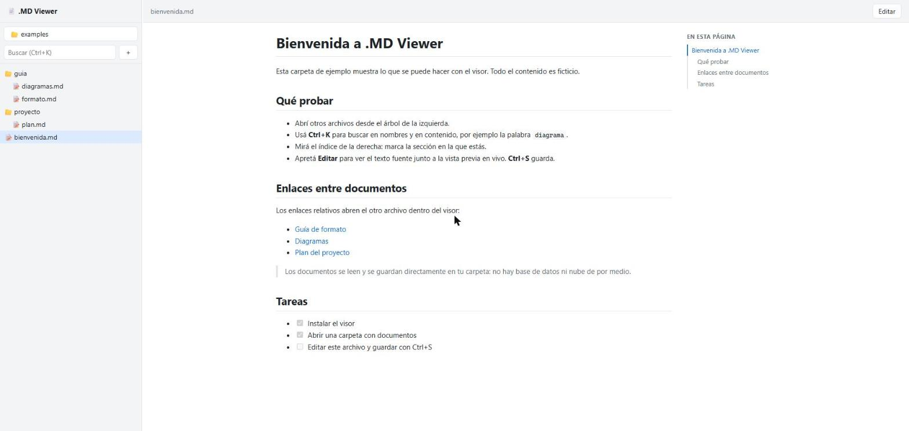
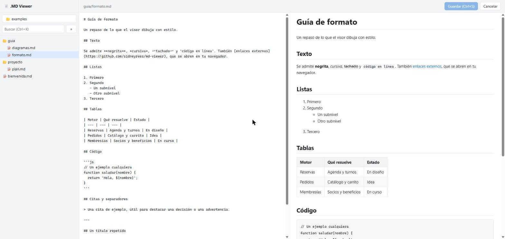
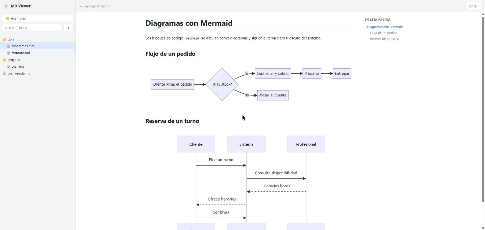
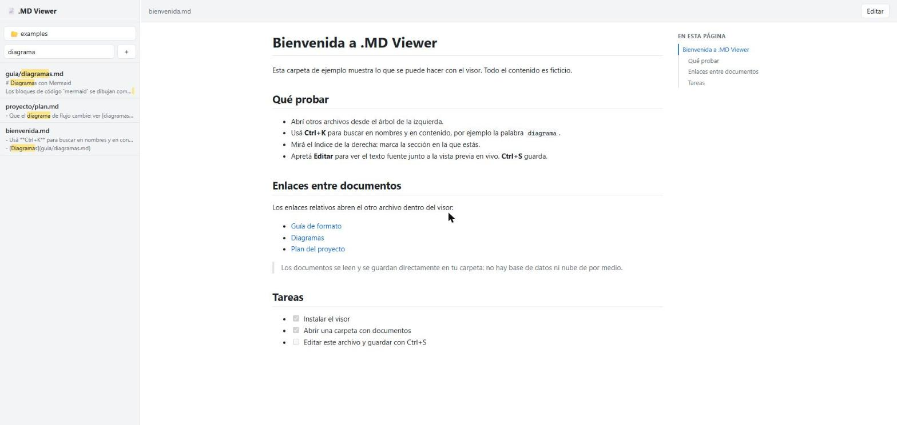

<div align="center">


# .MD Viewer

**Leé y editá tus documentos Markdown como se merecen.**<br />
Un explorador de carpetas a la izquierda, el documento con estilos a la derecha y edición con vista previa en vivo. Sin nube, sin cuentas, sin configuración.

[](LICENSE)




</div>

---

> *A desktop Markdown viewer and editor: folder tree, styled rendering, full-text search, outline, Mermaid diagrams and live-preview editing. Offline, private, no dependencies at runtime.*

## Por qué existe

Los archivos `.md` son excelentes para escribir y bastante incómodos para leer: texto plano lleno de símbolos, tablas que no se entienden, carpetas con decenas de documentos. **.MD Viewer** resuelve exactamente eso. Abrís una carpeta y navegás tus documentos como si fueran un sitio, con la comodidad de un explorador de archivos.

Es una herramienta pensada para leer mucho y editar un poco: documentación de proyectos, notas, especificaciones, bases de conocimiento, el `docs/` de cualquier repositorio.

## Qué hace

| | |
| --- | --- |
| 🗂️ **Árbol de carpetas** | Navegás como en el Explorador de Windows. Solo muestra las carpetas que contienen `.md`. |
| 🎨 **Lectura con estilos** | Títulos, listas, tablas, código, citas, listas de tareas e imágenes, con tema claro u oscuro según tu sistema. |
| 🔎 **Búsqueda (Ctrl+K)** | Busca en nombres y en el contenido de todos los documentos, con fragmentos resaltados. |
| 🧭 **Índice del documento** | Panel con los títulos del archivo, que marca la sección donde estás. |
| 📊 **Diagramas Mermaid** | Los bloques ` ```mermaid ` se dibujan como diagramas: flujos, secuencias, y más. |
| ✏️ **Edición con vista previa** | El texto fuente a un lado y el resultado en vivo al otro. **Ctrl+S** guarda en disco. |
| 🔗 **Enlaces entre documentos** | Los enlaces relativos entre `.md` se abren dentro del visor, y las imágenes relativas se muestran. |
| 📁 **Gestión de archivos** | Crear, renombrar, mover y eliminar documentos desde el árbol (clic derecho). |
| 🖱️ **Abrir con doble clic** | Registrado como editor de archivos `.md`: al abrir uno, el visor muestra su carpeta completa. |

<table>
  <tr>
    <td width="50%"><br /><sub><b>Edición</b> con vista previa en vivo</sub></td>
    <td width="50%"><br /><sub><b>Diagramas</b> Mermaid dentro del documento</sub></td>
  </tr>
  <tr>
    <td width="50%"><br /><sub><b>Búsqueda</b> en nombres y contenido</sub></td>
    <td width="50%"></td>
  </tr>
</table>

## Instalación

### Windows

Generá el instalador desde el código fuente (requiere [Node.js](https://nodejs.org) 20.11 o superior):

```bash
git clone https://github.com/sidneyrees/md-viewer.git
cd md-viewer
npm install
npm run dist
```

El instalador queda en `dist/MD-Viewer-<versión>-setup.exe` (unos 120 MB, porque incluye Electron). Permite elegir la carpeta de instalación, crea un acceso directo en el escritorio y registra la app como editor de archivos `.md`.

> El instalador no está firmado digitalmente, así que Windows SmartScreen puede mostrar un aviso la primera vez ("Windows protegió su PC"). Es esperable en software independiente sin certificado de firma.

### Probarlo sin instalar

```bash
npm install
npm start
```

### macOS y Linux

El código es multiplataforma y `npm start` debería funcionar, pero hoy el proyecto solo se probó y se empaqueta para Windows. Las contribuciones para empaquetar otras plataformas son bienvenidas.

## Uso

1. Abrí la app. La primera vez te muestra tu carpeta de Documentos.
2. Hacé clic en el botón con el nombre de la carpeta, arriba del árbol (o **Ctrl+O**), y elegí la carpeta de trabajo con el selector nativo. La app recuerda la última.
3. Elegí un documento en el árbol. Para editarlo, **Editar**; para guardar, **Ctrl+S**.

También podés hacer doble clic sobre cualquier `.md` (o ejecutar `"MD Viewer.exe" ruta\al\archivo.md`): se abre su carpeta y se selecciona el archivo. Si la app ya está abierta, reutiliza la misma ventana.

Para probarlo con material de muestra, abrí la carpeta [`examples/`](examples/) de este repositorio.

### Atajos

| Atajo | Acción |
| --- | --- |
| `Ctrl+O` | Elegir carpeta de trabajo |
| `Ctrl+K` | Buscar |
| `Ctrl+S` | Guardar (en modo edición) |
| `Esc` en la búsqueda | Limpiar y volver al árbol |
| `Ctrl+Plus` / `Ctrl+Minus` / `Ctrl+0` | Acercar, alejar y tamaño real |
| Clic derecho en un archivo | Renombrar o eliminar |

### Modo navegador

La misma interfaz funciona sin Electron, en una pestaña del navegador:

```bash
npm run web                          # abre http://127.0.0.1:4321
node src/cli.mjs <carpeta> [puerto]  # elegir carpeta y puerto
```

En este modo el selector de carpetas es uno propio de la página en lugar del diálogo nativo.

## Privacidad y seguridad

- **Todo es local.** No hay cuentas, telemetría ni conexiones a internet: las librerías vienen incluidas y la app funciona sin conexión.
- **Solo escucha en `127.0.0.1`**, en un puerto libre, y rechaza pedidos cuyo `Host` u `Origin` no sean los suyos (protege contra páginas web que intenten hablarle).
- **Solo toca archivos `.md`** dentro de la carpeta elegida. Crear y renombrar nunca pisan un archivo existente. **Eliminar es definitivo** desde el visor: si tu carpeta está en Git, tenés el respaldo.
- **El contenido se sanitiza.** El HTML que sale de un documento pasa por [DOMPurify](https://github.com/cure53/DOMPurify) y la página corre con una Content-Security-Policy estricta, así que abrir un `.md` de terceros no ejecuta código. La ventana usa aislamiento de contexto y sandbox, y expone al documento una sola capacidad: el diálogo para elegir carpeta.
- Los enlaces externos se abren en tu navegador, nunca dentro de la app.

## Desarrollo

```bash
npm install
npm start          # app de escritorio en modo desarrollo
npm test           # pruebas del servidor (node:test, sin dependencias)
npm run dist       # instalador de Windows en dist/
npm run dist:dir   # app desempaquetada en dist/win-unpacked/
npm run icon       # regenera build/icon.png
```

```text
src/
  main.mjs          proceso principal de Electron: ventana, menú, .md por doble clic
  preload.cjs       puente mínimo: el diálogo nativo de carpetas
  server.mjs        servidor local (API de archivos + archivos estáticos)
  cli.mjs           modo navegador
  renderer/         interfaz: index.html, app.js, styles.css y vendor/
examples/           carpeta de muestra con contenido ficticio
test/               pruebas del servidor
```

La interfaz no tiene paso de compilación: es HTML, CSS y JavaScript que Electron (o el navegador) carga tal cual. El servidor y la app comparten el mismo código.

> Si lanzás la app desde una terminal que define `ELECTRON_RUN_AS_NODE` (por ejemplo la integrada de VS Code), `electron .` se cierra apenas arranca. `npm start` ya limpia esa variable.

## Estado y próximos pasos

La versión 1.0 cubre lectura, búsqueda, índice, Mermaid, edición y gestión de archivos. Ideas abiertas, sin compromiso de fecha:

- Publicar el instalador en la sección *Releases* y firmarlo.
- Empaquetado para macOS y Linux.
- Interfaz en otros idiomas (hoy está en español).
- Resaltado de sintaxis en bloques de código y modo de edición con atajos de formato.

## Licencia

[MIT](LICENSE). Incluye, sin modificarlas, las librerías [marked](https://github.com/markedjs/marked), [mermaid](https://github.com/mermaid-js/mermaid) y [DOMPurify](https://github.com/cure53/DOMPurify); sus licencias están en [THIRD-PARTY-NOTICES.md](THIRD-PARTY-NOTICES.md). La app empaquetada incluye además [Electron](https://www.electronjs.org/) y Chromium con sus licencias.
