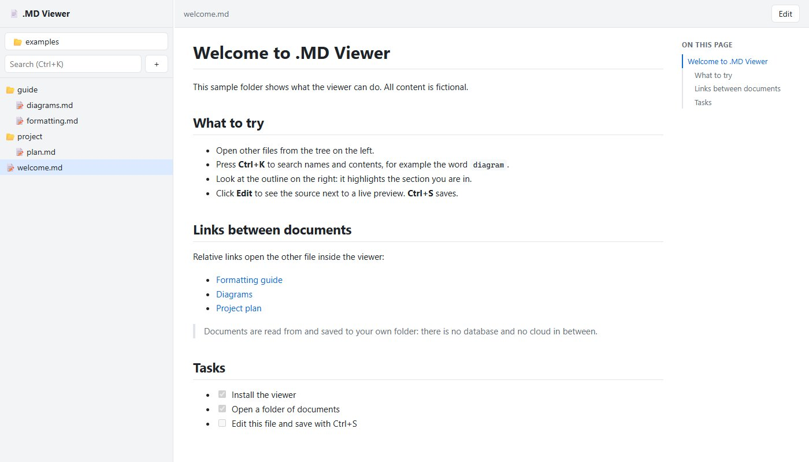
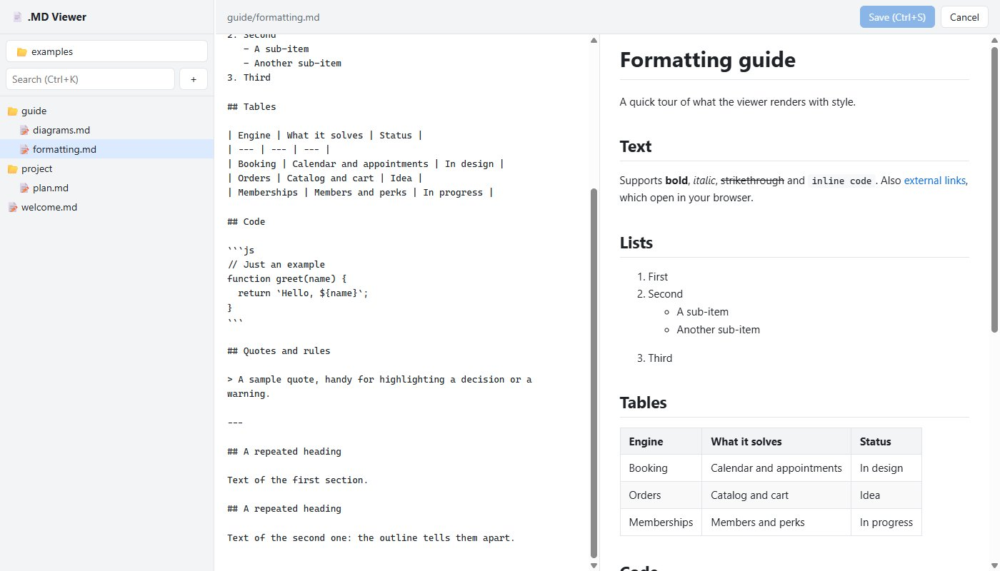
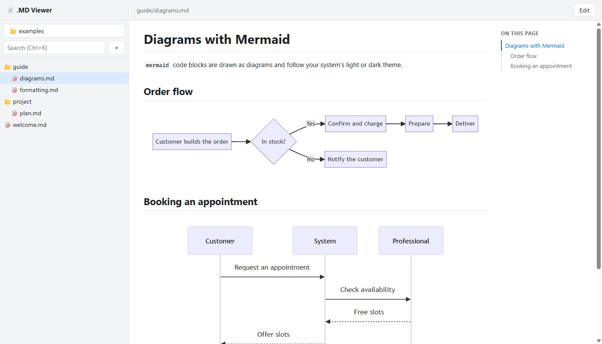
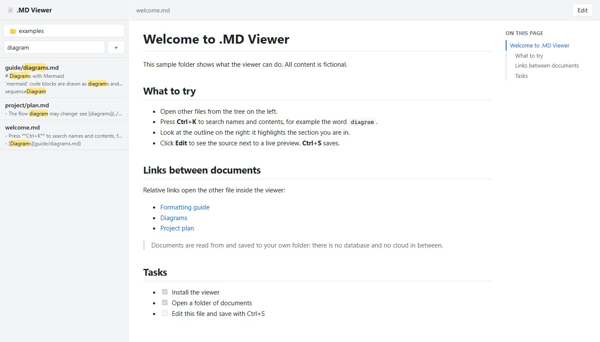

<div align="center">


# .MD Viewer

**Read and edit your Markdown documents the way they deserve.**<br />
A folder explorer on the left, the styled document on the right, and editing with a live preview. No cloud, no accounts, no setup.

[](LICENSE)




</div>

---

## Why it exists

`.md` files are great to write and rather uncomfortable to read: plain text full of symbols, tables you cannot make sense of, folders with dozens of documents. **.MD Viewer** fixes exactly that. Open a folder and browse your documents like a website, with the comfort of a file explorer.

It is built for reading a lot and editing a little: project documentation, notes, specifications, knowledge bases, the `docs/` folder of any repository.

## What it does

| | |
| --- | --- |
| 🗂️ **Folder tree** | Browse like in Windows Explorer. Only folders that contain `.md` files are shown. |
| 🎨 **Styled reading** | Headings, lists, tables, code, quotes, task lists and images, with a light or dark theme following your system. |
| 🔎 **Search (Ctrl+K)** | Searches file names and the contents of every document, with highlighted snippets. |
| 🧭 **Document outline** | A panel with the file's headings that highlights the section you are in. |
| 📊 **Mermaid diagrams** | ` ```mermaid ` blocks are drawn as diagrams: flowcharts, sequences and more. |
| ✏️ **Editing with preview** | Source on one side, live result on the other. **Ctrl+S** saves to disk. |
| 🔗 **Links between documents** | Relative links between `.md` files open inside the viewer, and relative images are shown. |
| 📁 **File management** | Create, rename, move and delete documents from the tree (right-click). |
| 🖱️ **Open with a double click** | Registered as an editor for `.md` files: opening one shows its whole folder in the viewer. |

<table>
  <tr>
    <td width="50%"><br /><sub><b>Editing</b> with a live preview</sub></td>
    <td width="50%"><br /><sub><b>Mermaid diagrams</b> inside the document</sub></td>
  </tr>
  <tr>
    <td width="50%"><br /><sub><b>Search</b> across names and contents</sub></td>
    <td width="50%"></td>
  </tr>
</table>

## Installation

### Windows

Build the installer from source (requires [Node.js](https://nodejs.org) 20.11 or later):

```bash
git clone https://github.com/sidneyrees/md-viewer.git
cd md-viewer
npm install
npm run dist
```

The installer ends up in `dist/MD-Viewer-<version>-setup.exe` (about 120 MB, because it bundles Electron). It lets you choose the install folder, creates a desktop shortcut and registers the app as an editor for `.md` files.

> The installer is not code-signed, so Windows SmartScreen may show a warning the first time ("Windows protected your PC"). This is expected for independent software without a signing certificate.

### Try it without installing

```bash
npm install
npm start
```

### macOS and Linux

The code is cross-platform and `npm start` should work, but the project has only been tested and packaged for Windows so far. Contributions to package other platforms are welcome.

## Usage

1. Open the app. The first time it shows your Documents folder.
2. Click the button with the folder name above the tree (or press **Ctrl+O**) and pick the working folder with the native picker. The app remembers the last one.
3. Choose a document in the tree. Click **Edit** to edit it and **Ctrl+S** to save.

You can also double-click any `.md` file (or run `"MD Viewer.exe" path\to\file.md`): its folder opens and the file is selected. If the app is already open, it reuses the same window.

To try it with sample material, open the [`examples/`](examples/) folder of this repository.

### Shortcuts

| Shortcut | Action |
| --- | --- |
| `Ctrl+O` | Choose working folder |
| `Ctrl+K` | Search |
| `Ctrl+S` | Save (in edit mode) |
| `Esc` in the search box | Clear and return to the tree |
| `Ctrl+Plus` / `Ctrl+Minus` / `Ctrl+0` | Zoom in, zoom out, actual size |
| Right-click a file | Rename or delete |

### Browser mode

The same interface works without Electron, in a browser tab:

```bash
npm run web                          # opens http://127.0.0.1:4321
node src/cli.mjs <folder> [port]     # choose folder and port
```

In this mode the folder picker is the page's own instead of the native dialog.

## Privacy and security

- **Everything is local.** No accounts, no telemetry, no internet connections: the libraries are bundled and the app works offline.
- **It only listens on `127.0.0.1`**, on a free port, and rejects requests whose `Host` or `Origin` is not its own (this protects against web pages trying to talk to it).
- **It only touches `.md` files** inside the chosen folder. Create and rename never overwrite an existing file. **Delete is permanent** from the viewer: if your folder is in Git, you have a backup.
- **Content is sanitized.** The HTML produced from a document goes through [DOMPurify](https://github.com/cure53/DOMPurify) and the page runs with a strict Content-Security-Policy, so opening a third-party `.md` does not run code. The window uses context isolation and the sandbox, and exposes a single capability to the document: the folder-picker dialog.
- External links open in your browser, never inside the app.

## Development

```bash
npm install
npm start          # desktop app in development mode
npm test           # server tests (node:test, no dependencies)
npm run dist       # Windows installer in dist/
npm run dist:dir   # unpacked app in dist/win-unpacked/
npm run icon       # regenerate build/icon.png
```

```text
src/
  main.mjs          Electron main process: window, menu, .md by double click
  preload.cjs       minimal bridge: the native folder dialog
  server.mjs        local server (file API + static files)
  cli.mjs           browser mode
  renderer/         interface: index.html, app.js, styles.css and vendor/
examples/           sample folder with fictional content
test/               server tests
```

The interface has no build step: it is plain HTML, CSS and JavaScript that Electron (or the browser) loads as is. The server and the app share the same code.

> If you launch the app from a terminal that defines `ELECTRON_RUN_AS_NODE` (for example VS Code's integrated one), `electron .` exits right after starting. `npm start` already clears that variable.

## Status and next steps

Version 1.0 covers reading, search, outline, Mermaid, editing and file management. Open ideas, with no committed dates:

- Publish the installer under *Releases* and sign it.
- Packaging for macOS and Linux.
- Interface translations (it is currently English only).
- Syntax highlighting in code blocks and formatting shortcuts in edit mode.

## License

[MIT](LICENSE). It bundles, unmodified, the libraries [marked](https://github.com/markedjs/marked), [mermaid](https://github.com/mermaid-js/mermaid) and [DOMPurify](https://github.com/cure53/DOMPurify); their licenses are in [THIRD-PARTY-NOTICES.md](THIRD-PARTY-NOTICES.md). The packaged app also includes [Electron](https://www.electronjs.org/) and Chromium with their licenses.
