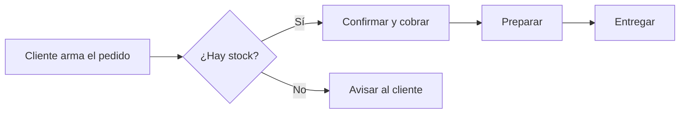
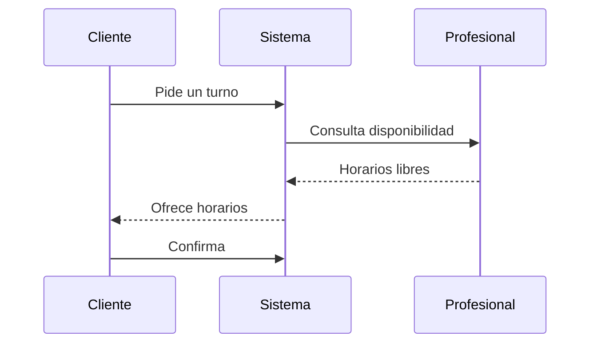

# Diagramas con Mermaid

Los bloques de código `mermaid` se dibujan como diagramas y siguen el tema claro u oscuro del sistema.

## Flujo de un pedido

## Reserva de un turno

Más material sobre el mismo tema en el [plan del proyecto](../proyecto/plan.md).
