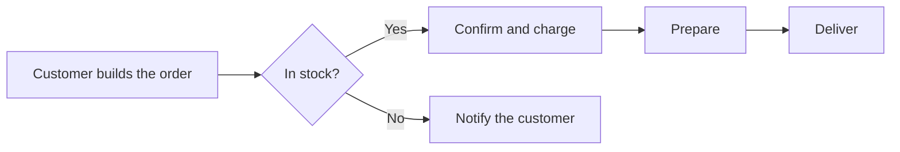
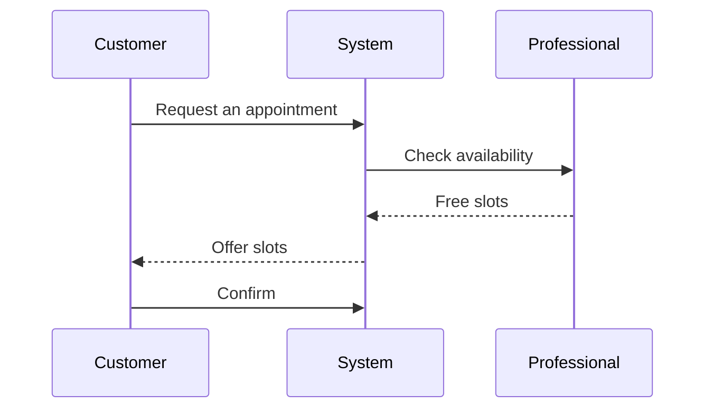

# Diagrams with Mermaid

`mermaid` code blocks are drawn as diagrams and follow your system's light or dark theme.

## Order flow

## Booking an appointment

More on the same topic in the [project plan](../project/plan.md).
